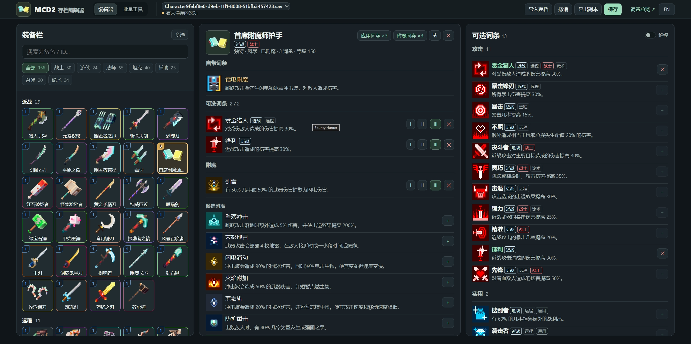

# MCD2 Batch Editor

[简体中文](README.md) | **English**

A save editor for Minecraft Dungeons II: add every unique item with one click and batch-edit rolled effects.

## Usage

- **Online** - Open the [editor](https://wlm3201.github.io/mcd2-batch-editor) and import/export your save manually
- **Desktop** - Download and extract the `.zip`, then run `start.bat`; it reads your save and creates backups automatically. Requires [Node.js](https://nodejs.org)
- **Standalone web page** - Download the `.html` file and open it in a browser
