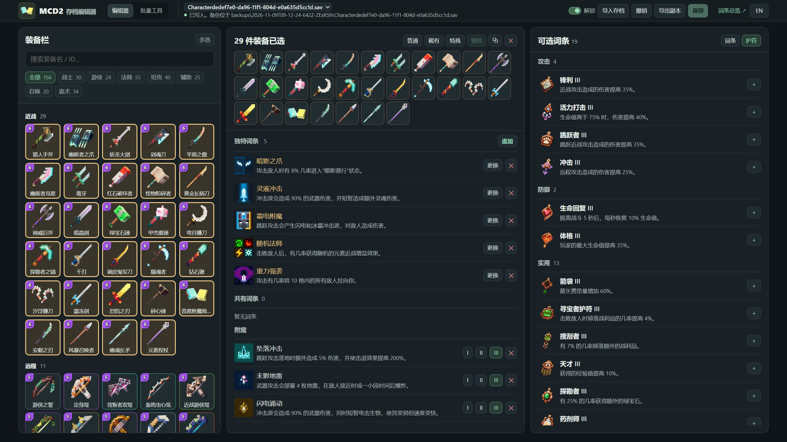

# MCD2 Save Editor

**简体中文** | [English](README.en.md)

**我的世界地下城2 Steam版 存档编辑器**

- 一键添加所有独特装备及图鉴、法器、护身符、附魔书
- 为装备添加可洗词条与附魔，遵循游戏的数量和候选池限制
- 多选装配批量添加词条，一键应用到同类装备
- 解锁限制：可修改独特词条，可添加多个附魔，可重复添加词条，可添加护身符词条
- 词条总览：按职业标签分类展示所有可洗词条效果
- 一键加满资源、完成任务、解锁车站、探索地图

## 使用

- **在线版** - 打开[编辑器](https://wlm3201.github.io/mcd2-save-editor)，手动导入导出存档
- **桌面版** - 下载`.zip`解压，打开`start.bat`，自动读取与备份，需[Node.js](https://nodejs.org)
- **网页版** - 下载`.html`，浏览器打开
